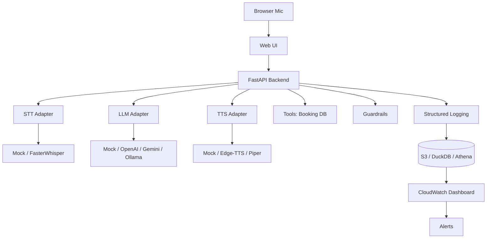

# Voice Assistant QA Platform

A comprehensive Quality Assurance framework for testing AI voice assistants, demonstrated through a clinic appointment booking system.

## Overview

This project showcases end-to-end QA capabilities for AI systems:
- **LLM Evaluation** (DeepEval, Ragas, custom G-Eval)
- **API Testing** (pytest, schemathesis, Postman/Newman)
- **Web Automation** (Playwright with fake media streams)
- **Performance Testing** (Locust)
- **Data Validation** (DuckDB, Athena SQL)
- **CI/CD** (GitHub Actions)
- **AWS Infrastructure** (Terraform, Lambda, CloudWatch)
- **Regression Detection** (Automated baseline comparison)

The system under test is intentionally simple: a voice assistant for clinic appointment booking. The QA layer is the main deliverable.

## Architecture



## Quick Start

### Prerequisites
- Python 3.11+
- [uv](https://github.com/astral-sh/uv) (recommended) or pip
- Node.js 18+ (for promptfoo)

### One-Command Setup

```bash
# Clone and enter
cd voice-assistant-qa

# Install dependencies (mock adapters - no API keys needed)
make install

# Run the server
make run
```

The server starts at `http://localhost:8000` with:
- API docs: `http://localhost:8000/docs`
- Web UI: `http://localhost:8000/web`

### Run Tests

```bash
# All tests (unit + API)
make test

# Specific test suites
make test-api         # API contract tests
make test-stt         # STT WER/CER tests (needs audio files)
make test-intent      # Intent/slot accuracy tests
make test-llm         # DeepEval LLM evaluation (relevancy, faithfulness, hallucination, G-Eval)
make test-multiturn   # Multi-turn conversation tests
make test-safety      # Safety/guardrails tests
make test-ui          # Playwright UI tests (needs running server)
make test-perf        # Locust load tests (needs running server)
make test-promptfoo   # Prompt regression tests
make test-visual      # Visual regression tests

# With real adapters (requires API keys in .env)
make install-real
# Edit .env with your keys
make test
```

### Data Generation

```bash
# Generate audio clips from manifest (requires edge-tts: npm install -g edge-tts)
make gen-audio

# Add background noise to clips
make augment-noise

# Validate manifest
make validate-manifest
```

### Regression-Catch Demo

```bash
# Run full regression demo (baseline → inject regressions → detect → fix)
python tools/regression_demo.py

# Run baseline evaluation for comparison
python tools/run_baseline.py --output reports/baseline
```

## Project Structure

```
voice-assistant-qa/
├── app/                    # FastAPI backend
│   ├── adapters/           # STT/LLM/TTS adapters (mock + real)
│   ├── tools/              # Booking database, FAQ
│   ├── guardrails/         # PII masking, injection detection
│   ├── s3_logging.py       # S3 log upload
│   ├── duckdb_queries.py   # Log validation queries
│   ├── schemas.py          # Pydantic models
│   ├── config.py           # Settings management
│   ├── logging_utils.py    # Structured JSON logging
│   └── main.py             # FastAPI app
├── web/                    # Plain HTML/JS/CSS UI
├── data/                   # Test datasets
│   ├── audio/              # Audio clips
│   ├── faq/                # Clinic FAQ + out-of-scope
│   └── golden/             # Golden evaluation dataset
├── tests/                  # QA test suites
│   ├── api/                # API contract tests
│   ├── stt/                # WER/CER tests
│   ├── intent/             # Intent/slot accuracy
│   ├── llm_eval/           # DeepEval/Ragas tests
│   ├── multiturn/          # Conversation tests
│   ├── safety/             # Guardrail tests
│   ├── ui/                 # Playwright tests
│   └── perf/               # Locust load tests
├── tools/                  # Dataset generation & demo scripts
├── promptfoo/              # Prompt regression configs
├── infra/                  # AWS Terraform/CDK
│   ├── athena/             # Athena DDL & queries
│   ├── cloudwatch/         # Dashboard & alarms
│   ├── iam/                # IAM policies
│   ├── lambda/             # Nightly eval Lambda
│   └── terraform/          # Terraform infrastructure
├── docs/                   # Documentation
└── .github/workflows/      # CI/CD pipelines
```

## Key Features

### System Under Test
- **Text & Audio Chat**: `/text/chat`, `/audio/chat` endpoints
- **Multi-turn Memory**: Session-based conversation context
- **Tools**: Check availability, book, cancel appointments
- **Guardrails**: PII masking, prompt injection detection, medical advice refusal
- **Pluggable Adapters**: Switch between mock/real via env vars
- **Structured Logging**: JSON lines with latency, tokens, cost, PII masking

### QA Framework
- **Audio Dataset**: 40 clips with manifest (accents, noise, languages) - extensible to 100+
- **STT Quality**: WER/CER with jiwer, sliced by conditions
- **Intent/Slot Accuracy**: From manifest ground truth
- **Error Propagation**: STT vs LLM failure classification
- **LLM Evaluation**: DeepEval (relevancy, faithfulness, hallucination, custom G-Eval)
- **Prompt Regression**: promptfoo with baseline comparison
- **Safety Testing**: promptfoo red-team + custom pytest
- **UI Automation**: Playwright with fake microphone streams
- **Performance**: Locust with per-stage latency breakdown
- **Data Validation**: DuckDB/Athena queries for log analysis
- **Regression Detection**: Automated baseline comparison demo

## Configuration

All settings via environment variables (see `.env.example`):

```bash
# Adapter selection
STT_ADAPTER=mock|faster-whisper
LLM_ADAPTER=mock|openai|gemini|ollama
TTS_ADAPTER=mock|edge-tts|piper

# Thresholds for QA gates
WER_THRESHOLD_CLEAN=0.10
INTENT_ACCURACY_THRESHOLD=0.90
```

## Running the Demo

1. Start server: `make run`
2. Open `http://localhost:8000/web`
3. Click "Start Recording" and speak
4. Try: "Book appointment for John tomorrow at 3 PM"
5. Assistant asks for confirmation → say "Yes"

## Test Reports

Reports generated in `reports/`:
- `api/` - API test results
- `stt/` - WER/CER reports
- `llm_eval/` - DeepEval HTML reports
- `safety/` - Safety test results
- `ui/` - Playwright traces, screenshots
- `perf/` - Locust HTML reports
- `validation/` - DuckDB validation queries
- `regression_demo/` - Regression demo results

## CI/CD

GitHub Actions workflows (`.github/workflows/ci.yml`):
- **PR Checks**: Lint, unit tests, API tests, smoke eval, safety, Playwright smoke
- **Nightly**: Full golden dataset, full UI suite, load test, S3 upload
- **Prompt Regression**: promptfoo on PR + nightly

## AWS Deployment

Infrastructure code in `infra/`:
- S3 bucket layout for datasets/logs/reports
- Lambda for nightly eval + Slack notification
- CloudWatch dashboard + alarms
- Least-privilege IAM policies
- Terraform modules

See `docs/aws_setup.md` for step-by-step guide.
See `infra/terraform/README.md` for Terraform deployment.

## Documentation

- `docs/architecture.md` - System design
- `docs/test_strategy.md` - QA methodology, non-determinism handling
- `docs/interview_notes.md` - Tool choices, interview Q&A
- `docs/aws_setup.md` - Deployment guide

## Regression-Catch Demo

The framework includes a complete regression detection demonstration:

1. **Baseline**: Run with Prompt v1 + Whisper base (mock) → saves to `reports/baseline`
2. **Inject STT Regression**: Switch to Whisper tiny → WER increases → tests fail
3. **Inject Prompt Regression**: Weaken confirmation requirement → safety tests fail
4. **Detect**: Full test suite catches both regressions
5. **Fix**: Restore Prompt v1 + Whisper base → tests pass again

Run it:
```bash
python tools/regression_demo.py
```

## Known Limitations

- Mock adapters are deterministic but simplified
- Real audio testing requires microphone permissions
- FAQ is synthetic - not a real clinic
- No real-time streaming (request/response only)
- Single-language (English/Hinglish) support
- Regression demo uses mock adapters for speed; real regressions need real adapters

## License

MIT - See LICENSE file